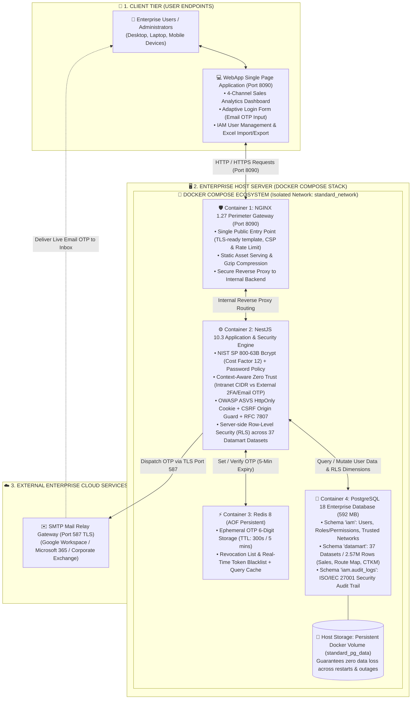
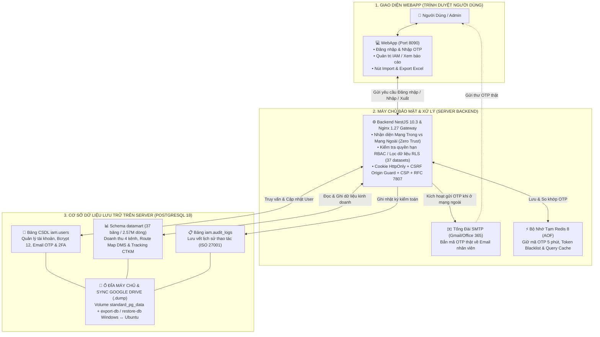

# CJ FOODS ENTERPRISE ARCHITECTURE SPECIFICATION
## SYSTEM ARCHITECTURE, NETWORK ZONING & SECURITY MECHANISMS

---

### 1. OVERALL SYSTEM ARCHITECTURE (ENGLISH)

---

### 2. SƠ ĐỒ VẬN HÀNH TIẾNG VIỆT (VIETNAMESE WORKFLOW)

---

### 3. DATABASE IMPORT & EXPORT WORKFLOWS

#### A. Nhập Dữ Liệu Hàng Loạt (Excel Import -> Database):
1. Admin tải lên file Excel danh sách người dùng (`.xlsx`).
2. WebApp đọc định dạng và hiển thị bảng Xem Trước (Preview).
3. Admin bấm "Tiến Hành Import".
4. Dữ liệu gửi đến `POST /api/v1/users/bulk-import`.
5. Backend mã hóa mật khẩu Bcrypt 12, thực hiện Upsert vào `iam.users` trong PostgreSQL.
6. Ghi nhật ký kiểm toán vào `iam.audit_logs`.

#### B. Xuất Dữ Liệu & Phân Quyền Hàng Dọc (Row-Level Security):
1. Người dùng bấm "Xuất Excel" trên giao diện.
2. Server xác thực danh tính người dùng qua HttpOnly Cookie.
3. Server áp dụng bộ lọc RLS:
   - Admin/BOD: Toàn quốc 4 kênh.
   - RSM: Chỉ miền phụ trách.
   - ASM: Chỉ vùng phụ trách.
   - GSBH/NPP: Chỉ NPP hoặc chi nhánh phụ trách.
4. Truy vấn CSDL PostgreSQL và trả về file Excel chuẩn hóa dữ liệu cho người dùng.
